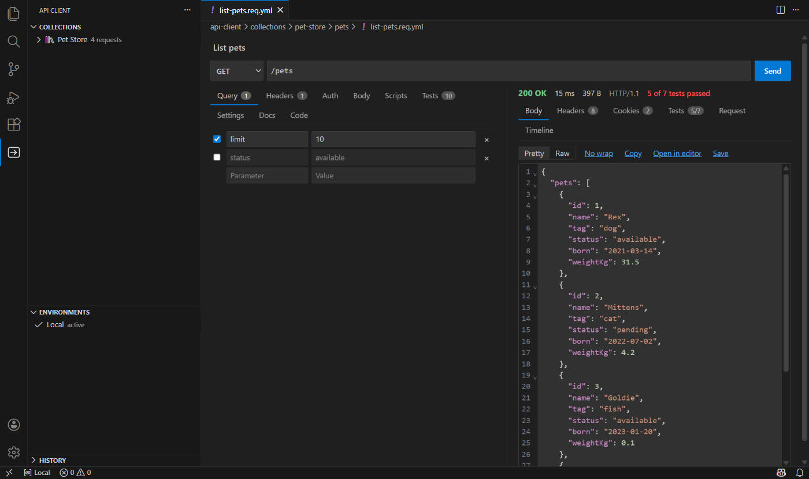
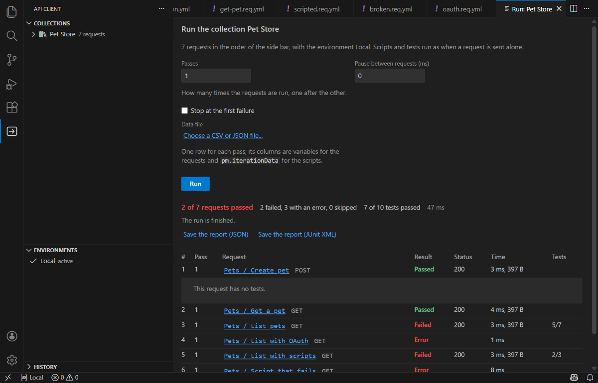

# API Client

[](https://github.com/nhech/api-client/actions/workflows/ci.yml)
[](LICENSE)

A free, **local-first API client for Visual Studio Code**. Your requests are plain files in your repository: no account, no limits on collections or requests, no telemetry, no server of ours. You write a request, press Send, and read the answer next to it. The same files are what Git shows in a pull request.

The extension sends the requests **you** send and, for a request that uses OAuth 2.0, the requests to the token server and the sign-in you configured; when you ask it to import an OpenAPI description from an address, it makes that one GET request. Nothing else leaves your machine.

> Not affiliated with or endorsed by Thunder Client, Postman, REST Client, httpYac or JetBrains. The names are used only to say which data formats are read or written.



- [What you get](#what-you-get)
- [Quick start](#quick-start)
- [The files](#the-files)
- [Variables, environments and secrets](#variables-environments-and-secrets)
- [Authentication](#authentication)
- [Tests and captures](#tests-and-captures)
- [Scripts](#scripts)
- [The collection runner](#the-collection-runner)
- [Importing, and the `.http` copy](#importing-and-the-http-copy)
- [Code, cookies and history](#code-cookies-and-history)
- [Settings](#settings)
- [Safety](#safety)
- [Known limits](#known-limits)
- [Development](#development) · [Documentation](#documentation) · [Contributing](CONTRIBUTING.md) · [Security](SECURITY.md) · [License](#license)

Vietnamese: [README.vi.md](README.vi.md).

## What you get

- **A request editor and a response pane side by side.** Method and address, then Query, Headers, Auth, Body (JSON, text, XML, form, multipart with files, GraphQL, a binary file), Scripts, Settings, Docs and Code. The answer has its body (pretty or raw; pictures are shown), headers, cookies, tests, the console of your scripts, the request as it was sent and a timeline (name lookup, connection, TLS, waiting, download).
- **Collections, folders and environments in the side bar**, native trees with drag and drop, rename, duplicate, move, filter, keyboard shortcuts and the colours of your theme. A folder or a collection sets what its requests share: a base address, headers, authentication, variables, tests, scripts and settings; the nearest one wins.
- **Requests are files.** One YAML file per request, folders for folders, the order of a folder kept in its file, bodies and scripts as readable blocks, so a change shows up line by line in a diff. A `.http` copy is written next to each request for the people who use REST Client, httpYac or the JetBrains client.
- **Variables and environments** with secret values kept out of Git. `{{name}}` in the address, headers, body, authentication; dynamic words such as `{{$guid}}`; a status bar item to change the environment.
- **Authentication:** inherit, none, bearer, basic, API key, and **OAuth 2.0** (client credentials, password, authorization code with PKCE, refresh), with the token kept in the secret storage of VS Code.
- **Tests and captures** as one-line rules (`status == 200`, `json $.id exists`, `token = json $.access_token`) and **JavaScript scripts before and after a request** (a subset of the `pm` API of Postman), run in a sandbox and only after you allowed the exact text.
- **A collection runner** with passes, a pause, a CSV or JSON data file, the stop at the first failure, and a JSON and a JUnit report.
- **Imports** from an **OpenAPI or Swagger** description (a file, or the address of a program that is running), from **the routes of your own controllers** (found in the source of the workspace), from Thunder Client, from Postman (collections and environments) and from cURL (copy a command, paste it as a request).
- **The Code tab** writes the request as cURL, PowerShell, JavaScript (fetch or axios), Python, Go, C#, PHP or Java, with the secrets left out.
- **Cookies and history**, and, for each request, folder or collection, redirects, timeouts, TLS verification and response limits. The proxy is the one of VS Code (`http.proxy`, `http.noProxy`) or of the environment (`HTTP_PROXY`, `HTTPS_PROXY`, `NO_PROXY`).
- **You can edit the files by hand.** *Open as Text* opens the YAML of any request, and the editor follows what you type.

## Quick start

Install **API Client** from the [Visual Studio Marketplace](https://marketplace.visualstudio.com/items?itemName=longtd.api-client) (Extensions view, search for it, or `ext install longtd.api-client`), or from Open VSX. It needs VS Code 1.100 or newer, a **trusted** local workspace (it is off in Restricted Mode, in the browser and in virtual workspaces) and runs where your files are (also over Remote SSH, WSL and containers, which have not been tried by hand yet).

1. Open a folder and the **API Client** icon in the Activity Bar. *New Collection...* creates `api-client/collections/<name>/`.
2. *New Request...* on the collection. Type an address, press **Ctrl+Enter** (**Cmd+Enter** on a Mac) or the Send button.
3. *New Environment...*, add `baseUrl` and use `{{baseUrl}}/pets` in your requests; pick the environment in the status bar.
4. Commit the `api-client/` folder. Values of secret variables are in `*.local.yml` files that the folder's own `.gitignore` keeps out of Git.

From a clone, to build the extension yourself:

```sh
git clone https://github.com/nhech/api-client.git
cd api-client
npm ci --ignore-scripts
npm run ext:build
cd extension && npm run package        # writes ../.artifacts/api-client.vsix
code --install-extension ../.artifacts/api-client.vsix
```

## The files

```
api-client/
  workspace.yml                 variables and settings of the whole workspace
  .gitignore                    keeps the *.local.yml files out of Git
  collections/
    petstore/
      collection.yml            base address, headers, auth, variables, tests, scripts, settings, order
      collection.local.yml      values of secret variables of the collection (not for Git, mode 0600)
      pets/
        folder.yml              what a folder sets, and the order of its requests
        list-pets.req.yml       one request
        list-pets.http          the .http copy, generated, do not edit
  environments/
    dev.env.yml                 the variables of an environment
    dev.env.local.yml           its secrets (not for Git)
```

A request, as it is on disk:

```yaml
schema: 1
id: 01J9Z4V0N2XK7Q3M8T5R6Y1ABC
name: Create pet
method: POST
url: '{{baseUrl}}/pets'
headers:
  - name: Content-Type
    value: application/json
auth:
  kind: bearer
  token: '{{token}}'
body:
  kind: json
  text: |-
    {
      "name": "Rex"
    }
tests:
  - expr: status == 201
captures:
  - expr: petId = json $.id
```

The reader is a strict subset of YAML (no anchors, aliases, tags or flow collections, no duplicate keys, limits on size and depth), so a file that came from somebody else is data and nothing else. A file that does not follow it is reported with the line, and *Open as Text* works on every request.

## Variables, environments and secrets

`{{name}}` is replaced by the value from the nearest scope that has it: what a capture or a script set while requests ran, then the variables of the folders and the collection from the nearest outwards, then the active environment, then the workspace. Dynamic words are looked up in a fixed table (`{{$guid}}`, `{{$uuid}}`, `{{$timestamp}}`, `{{$isoTimestamp}}`, `{{$randomInt a b}}`, `{{$randomBoolean}}`, `{{$randomString}}`, `{{$randomEmail}}`). Nothing between `{{ }}` is ever evaluated, so a request from a cloned repository cannot run code through a variable. In the editor, known variables, unknown ones and dynamic ones are marked, with the value on hover and completion after `{{`.

A variable can be marked **secret**. Its value is stored in the `*.local.yml` file next to the shared file (the `.gitignore` of the client folder is kept effective), and it is hidden wherever something is shown or written down: the history, the Code tab, the `.http` copy, reports, the console, error messages. A name that looks like a secret (`token`, `password`, `api_key`...) that a script or capture sets is a secret from then on.

What requests and scripts set while they run lives in memory, belongs to the collection that set it, and is never written to a file. *Clear Saved Variables* forgets it.

## Authentication

Set on a request, a folder or a collection, and inherited: **none**, **bearer**, **basic**, **API key** (in a header or in the query), **OAuth 2.0**. For OAuth the Auth tab shows whether there is a token, with *Get a token* and *Forget the token*. The first time a collection is to send credentials to a token server, you are asked, naming the server; credentials are only sent over https (or to this computer). See [docs/client/oauth.md](docs/client/oauth.md).

## Tests and captures

One line each, in a small grammar that is read by code that knows nothing else (a line that is not in it is a failed test with the reason, never something that is run):

```
status == 200
duration < 500
header content-type includes json
body includes ok
json $.items exists
petId = json $.id                 a capture: saves a variable for the next request
```

The Tests tab of the answer shows each result. Regular expressions run in an engine of their own that cannot be made to loop forever.

## Scripts

A request, folder or collection can hold a script that runs before the request and one that runs after the answer, in JavaScript with a subset of the Postman API (`pm.variables`, `pm.environment`, `pm.request`, `pm.response`, `pm.test`, `pm.expect`, `pm.sendRequest`, `pm.cookies`, `postman.setNextRequest`...).

A script can read every variable it is given, secrets included, and send them anywhere. So **nothing runs until you have said yes to the exact text**, in a question that shows each script; any change to a script (a pull, a branch switch, an edit) asks again, and an import never grants it. Scripts run in QuickJS compiled to WebAssembly in a worker thread, with limits on time, memory, output and calls, and can reach nothing but a short list of operations that the extension checks. Read [docs/client/scripts.md](docs/client/scripts.md) before you allow one, and the residual risk in [SECURITY.md](SECURITY.md). `apiClient.scripts.enabled` turns scripts off altogether.

## The collection runner



*Run Collection or Folder* runs the requests in the order of the side bar, shows each result as it comes (passed, failed, error, skipped; the tests with their messages) and saves a report as JSON or JUnit XML. Options: passes, a pause between requests, stop at the first failure, and a data file (CSV or JSON, one row for each pass). Scripts can steer the run with `setNextRequest` and `skipRequest`. See [docs/client/runner.md](docs/client/runner.md).

## Importing, and the `.http` copy

*Import...* reads what other tools made and writes nothing until you say yes: an **OpenAPI or Swagger** description (Swagger 2.0, OpenAPI 3.0 and 3.1, JSON or YAML, from a file or fetched from an address: a folder for each tag, a request for each operation with its parameters, a body made from the example or the schema, its authentication and a status test, and the servers as environments), **the routes of the controllers** in the source of your workspace, **Thunder Client** data (collections, folders with what they set, requests, environments), **Postman** collections v2.0 and v2.1 and environments, and a **cURL** command from the clipboard. A credential that is typed into an imported request becomes a secret variable of the collection. What could not be carried over is a list of notes, one command away. Nothing an importer reads is run. See [docs/client/import.md](docs/client/import.md).

Each request has a generated **`.http` copy** next to it (setting `apiClient.mirror.mode`: `on`, `off` or `gitignored`). It never holds a secret or anything the other tools would run or read; a copy you edited is never overwritten, and you can take its edits into the request, show the difference, discard them or keep the file as your own. See [docs/client/mirror.md](docs/client/mirror.md).

The older converter, which turns Thunder Client data straight into `.http` files for REST Client, httpYac or the JetBrains client (a command and a command line), is still here: [docs/converter.md](docs/converter.md).

## Code, cookies and history

- **Code** tab: the request as it would be sent now, in nine languages; nothing is sent and every secret is `[redacted]` ([docs/client/code-and-cookies.md](docs/client/code-and-cookies.md)).
- **Cookies**: kept per site and sent back to the same site; persistent ones in the secret storage of VS Code; the list never shows a value.
- **History**: by day, newest first, on this computer for this workspace, at most 200 entries for 30 days; by default only a line for each send (`apiClient.history.mode`: `metadata`, `full` or `off`) ([docs/client/history.md](docs/client/history.md)).

## Settings

| Setting | Meaning |
|---|---|
| `apiClient.root` | the folder of the workspace that holds the client's files (default `api-client`) |
| `apiClient.mirror.mode` | the `.http` copies: `on` (default), `off`, `gitignored` |
| `apiClient.history.mode` | `metadata` (default), `full`, `off` (a machine setting: a repository cannot change it) |
| `apiClient.scripts.enabled` | run scripts after you allowed them (a machine setting) |

Timeouts, redirects, TLS verification, response size limits, cookies and the redirect to a private network are settings of a request, a folder or a collection (the Settings tab), inherited like everything else.

## Safety

The data it reads comes from other people (a cloned repository, answers of servers, files of other tools), so it is treated as hostile: files are parsed as data and never run, paths cannot leave the collection, a redirect never takes your credentials to another origin or goes from the internet to your machine or network unless you allow it, secrets are covered by what they are and by what they are called wherever something is written down, scripts need your consent for the exact text, and the pages have no network and a strict Content-Security-Policy. [SECURITY.md](SECURITY.md) lists what it defends against, what it does not (a script you allowed can read every variable it is given), the audits it went through and how to report a problem.

## Known limits

- HTTP/1.1 only for now (no HTTP/2), no WebSocket, server-sent events or gRPC, no digest, AWS or NTLM authentication, no client certificates, no SOCKS or PAC proxy.
- Reading and checking the `.http` copy of every request is paid again for the whole collection when one file changes: up to a thousand requests nobody notices; at ten thousand every edit holds the extension host for seconds ([docs/client/performance.md](docs/client/performance.md)).
- Remote SSH, WSL and containers, and the secret storage of a remote machine, have not been verified by hand.
- Not available in Restricted Mode, in the browser or in virtual workspaces.
- A preview: file formats can still change between versions (the files carry `schema: 1` and are migrated).

## Development

```sh
npm ci --ignore-scripts
npm run check          # typecheck, extension typecheck, lint, all tests, tool self-test
npm test               # compile the tests and run node --test
npm run mutate         # breaks the rules that protect something on purpose and demands that the tests fail (slow)
npm run ext:host-test  # runs the extension in an installed VS Code with a throw-away profile
node scripts/package-extension.cjs   # builds the .vsix and verifies what is in it
```

```
src/core/        model, inheritance, variables, tests, cookies, redaction (pure)
src/format/      the YAML subset and the .http reader (pure)
src/storage/     reading and writing the files of a workspace
src/engine/      the HTTP engine, redirects, OAuth 2.0 (node:http and node:https)
src/script/      the sandbox for scripts (QuickJS in a worker thread)
src/runner/ src/history/ src/importers/ src/mirror/ src/codegen/ src/view/
src/reader/ src/normalize/ src/convert/ src/emit/ src/write/   the Thunder Client converter
extension/       the VS Code layer, and the pages (Preact) under extension/src/webview/
test/            unit tests, mock servers, fixtures and goldens
tools/           mutate.cjs (mutation check), thunder-structure.cjs (describe your data)
site/, scripts/  the landing page and the scripts that build, check, deploy it and package the extension
```

Every directory of `src/` may import only what its zone allows (`test/support/zones.ts`, checked by `test/unit/purity.test.ts`): the core is pure, only the engine uses the network modules, only the script zone uses the sandbox, and only `extension/` uses `vscode`.

## Documentation

- [docs/client/](docs/client/): how each part works: [scripts](docs/client/scripts.md), [OAuth 2.0](docs/client/oauth.md), [the runner](docs/client/runner.md), [the `.http` copy](docs/client/mirror.md), [importing](docs/client/import.md), [history](docs/client/history.md), [code and cookies](docs/client/code-and-cookies.md), [performance](docs/client/performance.md).
- [docs/converter.md](docs/converter.md): the Thunder Client to `.http` converter, with its command line.
- [docs/SPEC.vi.md](docs/SPEC.vi.md): the specification of the converter, in Vietnamese.
- [SECURITY.md](SECURITY.md), [CONTRIBUTING.md](CONTRIBUTING.md), [CHANGELOG.md](CHANGELOG.md), [site/README.md](site/README.md) (the landing page).

## License

[MIT](LICENSE) © 2026 longtd.
