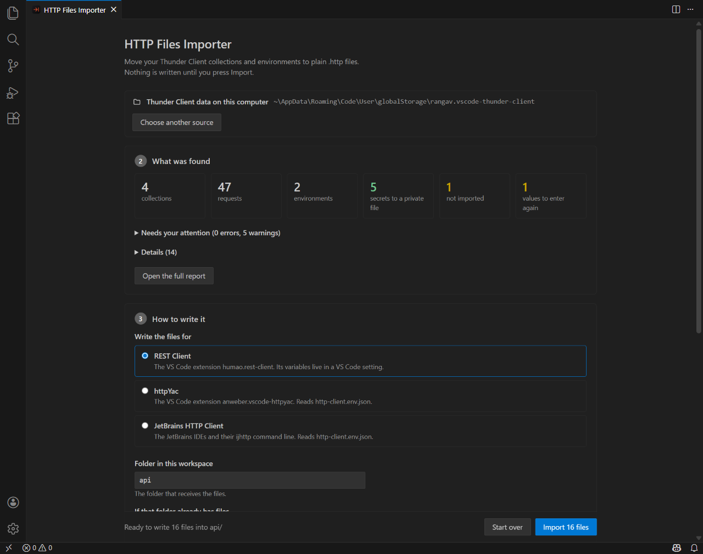

# HTTP Files Importer

[](https://github.com/nhech/api-client/actions/workflows/ci.yml)
[](LICENSE)

Nhập collection và môi trường của [Thunder Client](https://www.thunderclient.com/) thành các **file `.http`** thường, mở được bằng [REST Client](https://marketplace.visualstudio.com/items?itemName=humao.rest-client), [httpYac](https://marketplace.visualstudio.com/items?itemName=anweber.vscode-httpyac) và [JetBrains HTTP Client](https://www.jetbrains.com/help/idea/http-client-in-product-code-editor.html).

Chạy hoàn toàn trên máy bạn: không tài khoản, không mạng, không telemetry. Request của bạn nằm trong file đọc được, so sánh được và commit được.

> Không liên kết với, cũng không được Thunder Client xác nhận. Tên chỉ dùng để chỉ định dạng dữ liệu được đọc.

English: [README.md](README.md) (bản đầy đủ nhất).

## Có gì

- **Đọc thẳng dữ liệu Thunder Client trên đĩa**, chỉ đọc: bố cục v4 (`collections/tc_col_*.json`, `environments/tc_env_*.json`), bố cục v3 cũ (`thunderclient.json`, `thunderCollection.json`, `thunderEnvironment.json`) và file xuất `.json`. Không cần đăng nhập gì.
- **Thư mục, thứ tự, kế thừa.** Header, xác thực, base URL và test đặt ở collection hay thư mục được ghi vào từng request, đúng như Thunder Client áp dụng.
- **Đầu ra `.http` thường**, mỗi thư mục một file, kèm tệp môi trường mà từng công cụ đọc được.
- **Bí mật không vào Git.** Token, mật khẩu, khóa dạng hằng được thay bằng `{{biến}}` (tìm theo **tên**: header, query, trường form, tham số đường dẫn, mật khẩu trong URL, và tên trong thân JSON, XML, chuỗi truy vấn, GraphQL; một token không có tên đi kèm, như văn bản tự do trong thân, không nhận ra được nên vẫn nằm lại, hãy xem lại thân request của collection do người khác tạo trước khi commit); giá trị nằm ở một tệp riêng tư được thêm vào `.gitignore` và ghi với quyền `0600`.
- **Báo cáo** `IMPORT_REPORT.md`: cái gì đã nhập, cái gì bỏ và vì sao, bạn còn phải làm gì. Chỉ có tên và vị trí, không bao giờ có giá trị.
- **An toàn từ thiết kế.** Dữ liệu của collection do người khác tạo không thể thêm request vào file, đọc tệp của bạn, hay chạy mã khi bạn bấm Gửi.
- **Ba cách chạy:** dòng lệnh, lệnh trong VS Code (**HTTP Files Importer: Import from Thunder Client...**), và thư viện.

## Bắt đầu nhanh

Cần Node.js 22 trở lên. Gói chưa đăng lên npm nên dựng từ bản clone:

```sh
git clone https://github.com/nhech/api-client.git
cd api-client
npm ci --ignore-scripts
npm run build
```

Dòng lệnh (không có `--write` thì chỉ chạy thử: in báo cáo và danh sách tệp, không ghi gì):

```sh
node dist/cli.js "<thư mục dữ liệu Thunder Client>"                  # chạy thử
node dist/cli.js "<thư mục dữ liệu Thunder Client>" --write           # ghi vào ./api cho REST Client
node dist/cli.js export.json --target jetbrains --workspace ~/du-an --out requests --write
```

Tùy chọn: `--write`, `--workspace <thư mục>`, `--out <thư mục>` (mặc định `api`), `--policy new-folder|skip-existing|overwrite` (mặc định `new-folder`: thư mục đã có tệp thì không đụng, dùng `api-2`), `--target rest-client|httpyac|jetbrains` (mặc định `rest-client`), `--no-move-secrets`.

Thunder Client lưu dữ liệu ở (VS Code; Cursor, VSCodium... thì đổi `Code`):

| Hệ điều hành | Thư mục |
|---|---|
| Windows | `%APPDATA%\Code\User\globalStorage\rangav.vscode-thunder-client` |
| macOS | `~/Library/Application Support/Code/User/globalStorage/rangav.vscode-thunder-client` |
| Linux | `~/.config/Code/User/globalStorage/rangav.vscode-thunder-client` |

Dùng Git sync của Thunder Client thì trỏ vào thư mục `thunder-tests`. Muốn xem *hình dạng* dữ liệu mà không lộ nội dung: [`tools/thunder-structure.cjs`](tools/README.md).

**VS Code:** dựng extension rồi cài từ file: `npm run ext:build`, `cd extension && npm run package`, `code --install-extension ../.artifacts/http-files-importer.vsix`. Chạy lệnh **HTTP Files Importer: Import from Thunder Client...** trong Command Palette (hoặc bấm nút ở mục "HTTP Files Importer" trong Explorer): một **panel** hiện ra, gợi ý thư mục dữ liệu tìm thấy, cho xem đã đọc được gì và cái gì cần chú ý, cho chọn công cụ đích, thư mục và chính sách, và chỉ ghi khi bạn bấm **Import**. Có bản hỏi từng bước bằng Command Palette: **Import from Thunder Client (step by step)...**. Hủy ở bước nào cũng không ghi gì.



 Với đích REST Client, lệnh còn **tự điền cài đặt** `rest-client.environmentVariables` (biến chung vào cài đặt workspace, bí mật vào cài đặt người dùng và loại khỏi Settings Sync; giữ chú thích và mọi giá trị bạn đã có).

## Chọn công cụ đích

Ba công cụ đọc cùng request nhưng khác nhau ở hai chỗ nên tệp được viết cho một công cụ (`--target`, hoặc mục "Written for" trong VS Code):

- **Biến môi trường:** httpYac và JetBrains đọc `http-client.env.json`; REST Client không đọc, nó dùng cài đặt VS Code (importer viết thêm `rest-client.settings.json` và `rest-client.private.settings.json` cho đích này).
- **Biến động của Thunder Client:** `{{#guid}}` thành `{{$guid}}` (REST Client, httpYac) hay `{{$uuid}}` (JetBrains); `{{#number, a, b}}` thành `{{$randomInt a b+1}}` hay `{{$random.integer(a, b+1)}}` (cả ba công cụ dừng *trước* cận trên, Thunder Client thì gồm cả cận trên); `{{#dateISO}}` thành `{{$datetime iso8601}}` hay `{{$isoTimestamp}}`. Biến khác không có tương đương chính xác nên giữ nguyên và liệt kê trong báo cáo.

## An toàn

Dữ liệu collection có thể đến từ bất kỳ ai nên importer coi nó là thù địch: đọc chỉ-đọc và có giới hạn, không thực thi dữ liệu; không giá trị nào thêm được dòng vào file; body có dòng bắt đầu bằng `#`, `//`, `<`, `>` được lưu ở `_bodies/` (các công cụ coi chúng là chú thích, lệnh đọc tệp hay bộ xử lý phản hồi); chữ giữa `{{ }}` không phải tên biến thuần bị làm vô hại (httpYac chạy nó như JavaScript); ghi qua thư mục tạm và hoàn tác khi lỗi, không đi qua liên kết; bí mật chỉ nằm ở tệp riêng tư. Chi tiết: [SECURITY.md](SECURITY.md).

## Giới hạn

- **Dựng từ thông tin công khai và việc đọc mã của extension, thử bằng dữ liệu tự dựng cho khớp.** Tác giả chưa có thư mục dữ liệu v4 thật để thử. Nếu dữ liệu của bạn nhập sai, hãy mở issue kèm kết quả của [`tools/thunder-structure.cjs`](tools/README.md) (chỉ in cấu trúc, không in giá trị).
- **Chưa có runtime:** `# @assert` và `# @capture` được ghi ra nhưng chưa có gì chạy chúng.
- Extension đang ở bản preview, chưa có trên Marketplace.

## Phát triển

`npm run check` (kiểu, kiểu của extension, lint, mọi test, tự kiểm của công cụ), `npm run mutate` (phá cố ý 33 quy tắc và đòi test đỏ), `UPDATE_GOLDEN=1 npm test` (ghi lại golden sau một thay đổi có chủ ý; đọc diff rồi mới nhận), `npm run ext:host-test` (chạy extension trong VS Code đã cài với profile tạm). Mã nguồn chia tầng thuần (đọc → chuẩn hóa → chuyển đổi → phát ra) và chỉ `src/write/` ghi đĩa; test canh điều đó. Xem [CONTRIBUTING.md](CONTRIBUTING.md).

Đặc tả đầy đủ (tiếng Việt): [docs/SPEC.vi.md](docs/SPEC.vi.md).

## Giấy phép

[MIT](LICENSE) © 2026 longtd.
